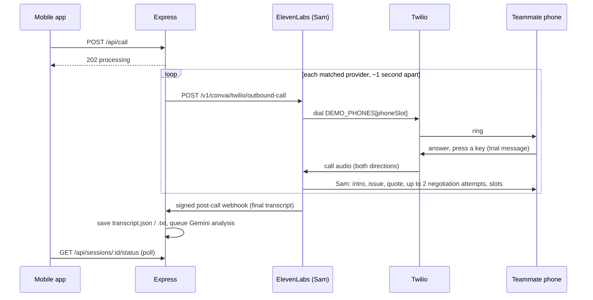

# CallAi

CallAi helps people who cannot use a spoken phone call compare repair offers. A photo and a written description are enough to start. An AI voice agent calls demo providers, and the user reviews the results and sends a booking request.

## Overview

CallAi is an accessibility-focused mobile app. A user submits a repair photo and a written issue, answers a few questions, compares service-provider offers, and requests an appointment without speaking on the phone.

The app is Expo / React Native. A Node.js and Express backend uses Gemini to understand the problem and compare offers. ElevenLabs and Twilio place the provider calls. Resend sends the booking request email. The demo uses configured demo providers, not real businesses.

## Problem

Getting a repair quote usually means calling several providers and explaining the same problem each time. That phone call is an accessibility barrier for people who cannot speak or cannot use spoken phone conversations. They can show what is wrong and write it down. They should still be able to compare price, scope, and availability.

## Solution

1. Submit a problem photo and written description.
2. Answer two image-grounded questions.
3. Find matching demo providers.
4. Let the AI voice agent call providers.
5. Compare offers, prices, and availability.
6. Send a booking request to the selected provider.

## Key Features

- Image and text-based service request
- Image-grounded follow-up questions
- AI-assisted provider conversations
- Price and availability comparison
- Accessibility without speaking or microphone access
- Simulated-call mode for testing
- Booking request email
- Four supported service categories: `electrical_appliances`, `plumbing`, `vehicle`, and `carpentry`
- Demo providers instead of real businesses

## User Flow

```text
Problem photo + written issue
→ follow-up questions
→ provider matching
→ AI calls providers
→ offer comparison
→ provider and time selection
→ booking request email
```

There is no ZIP input, no login, and no separate category-approval screen. A loading state sits between the call tap and the comparison.

1. The user takes or selects a required photo and types the issue. An optional nonnegative job budget can be included. Example: an under-sink pipe photo and “Water is leaking from the pipe under my kitchen sink.” Without a valid image, the flow stops.
2. `POST /api/intake` validates the image and text. Gemini sees both in one request and stores exactly two multiple-choice questions grounded in visible observations. Raw image bytes are then discarded. Intake never places a call.
3. The user taps one saved option for each question. `POST /api/answers` checks the options and stores a versioned brief and exactly one category. Calls stay off. Replacing answers invalidates the previous brief.
4. The summary states the user’s reported problem. It is not a diagnosis.
5. `GET /api/providers` returns only a count and a short message, such as “I found N providers who may be able to help.” The button reads **Call N providers**. Names and listing ranges stay hidden. N is the real match count. An empty category returns zero and disables the button.
6. **Call N providers** is the only call trigger. `POST /api/call` loads the brief and saved match IDs, resolves numbers from `DEMO_PHONES`, and starts one call per provider about one second apart. Repeated starts do not duplicate a session/provider call. The route returns `processing`.
7. The app shows “Calling providers and comparing offers” and polls `GET /api/sessions/:sessionId/status` about every three seconds, backing off on errors. Work continues if the app is backgrounded. Reopening the saved session ID loads completed results. The user never speaks or receives a call.
8. The worker writes transcripts, extracts terms, and compares offers. Failed calls appear as exclusions. The results screen shows names, scope, price basis, availability, negotiated reduction, and a recommendation only when comparable terms support one.
9. The user selects one provider and one saved future time, enters the service address and contact details as text, and taps **Send booking request**. That tap is the only send trigger.
10. Resend emails only that provider’s configured demo address. The app shows “Booking request sent — awaiting provider confirmation.” A sent or delivered email is not a confirmed appointment.

## Supported Service Categories

Gemini must return exactly one of these values. The same strings are prompt output, JSON validation, and directory keys.

| Category id | What it covers |
| --- | --- |
| `electrical_appliances` | Washing machines, refrigerators, ovens, fans, and other electrical household appliances |
| `plumbing` | Leaking pipes, taps, sinks, toilets, and drainage problems |
| `vehicle` | Cars, motorcycles, and other vehicle problems |
| `carpentry` | Wooden furniture, doors, cabinets, hinges, and other wooden fixtures |

Classification uses the photo, the written issue, and both answers. It labels the object and the work the user needs, not a background object. An appliance leak can be appliance repair rather than plumbing. One question may resolve a category boundary or a photo/text conflict. There is no extra approval step.

`suggestedService` and `serviceCategory` must each be one of the four values for an accepted image. `other`, `unknown`, `general`, a new trade, a list, or multiple categories are invalid. Express retries or rejects invalid model output. It does not map that output onto a different trade. A missing or unreadable image is an intake error or a retake, not a fifth category. A nearest-category label is not a diagnosis and not proof a provider can do the job.

Express selects `PROVIDERS_BY_SERVICE[serviceCategory]`. Plumbing records are never used for another category.

## Provider Data

Providers are hardcoded demo records in the planned file `backend/src/data/providers.js`. There is no ZIP-code search and no web search. Matching happens on the backend from the validated category. The mobile client cannot supply phone numbers or recipient emails.

Provider names and price ranges stay hidden until final results. Phone numbers live only in `DEMO_PHONES`. Email addresses live only in the server directory. Calls go only to teammate demo numbers. Real businesses are never called.

Listing ranges are demo context for a stated example job. They are not accepted quotes. A negotiation target may start near that provider’s lower listed bound for comparable work, and it stays inside an optional user budget. The target is not displayed as the provider’s final price. An inspection-only or hourly listing is not used as the anchor for a full repair.

The plumbing rows below are demo data, not live businesses. The other three categories start as empty lists, so their match count is zero until demo rows are added.

| ID | Name | Location | Example range (USD) | Phone slot |
| --- | --- | --- | --- | --- |
| `bluewave` | Bluewave Plumbing | College Park, MD | 150–300 | 0 |
| `shellback` | Shellback Repairs | Greenbelt, MD | 175–350 | 1 |
| `tidepool` | Tidepool Plumbing | Hyattsville, MD | 125–275 | 2 |
| `kelp` | Kelp Home Services | Riverdale Park, MD | 100–250 | 3 |

Selecting one provider emails that row’s single configured demo address.

## Accessibility

The primary audience is people who cannot speak or cannot use spoken phone conversations. Every core step is text, images, and taps.

- The required image can come from the camera or the photo library. Camera permission is requested only when taking a photo. Without an image, the flow cannot continue.
- No microphone permission, voice recording, spoken confirmation, or user phone conversation is required.
- The user describes the issue, answers questions, sees the matching count, starts calls, waits, compares results, and requests a booking.
- Controls have clear labels and accessible names. Text scales. Contrast stays readable.
- Loading, success, failure, and recommendation states use readable text. They are not communicated by sound or color alone. The loading message is explicit, for example “Calling providers and comparing offers.”
- Sam identifies itself as an AI assistant acting for the user and shares only the service issue and relevant requirements.
- Sam does not disclose or infer the user’s disability.
- Accessibility is required on each step. It is not a separate onboarding or verification screen.

## Repository Structure

Planned layout. These files are not in the repository yet. The repository currently contains this README and `LICENSE`.

```text
mobile/app/index.jsx                      required photo and written issue
mobile/app/questions.jsx                  two image-grounded questions
mobile/app/call.jsx                       summary, match count, and Call N providers
mobile/app/loading.jsx                    loading until the comparison is ready
mobile/app/results.jsx                    final offers and recommendation only
mobile/app/booking.jsx                    select time and details, send the email
mobile/lib/api.js                         HTTP requests and status polling
mobile/lib/session.js                     remember the non-secret active session ID
mobile/.env.example                       public backend base URL only
backend/src/server.js                     Express HTTP server
backend/src/routes/intake.js
backend/src/routes/questions.js
backend/src/routes/answers.js
backend/src/routes/providers.js           count only; matched IDs stay server-side
backend/src/routes/calls.js               start the call batch
backend/src/routes/sessions.js            readiness and final results
backend/src/routes/elevenlabs-webhook.js  signed completed-call callback
backend/src/routes/bookings.js
backend/src/routes/resend-webhook.js
backend/src/data/providers.js             categories, listing ranges, and demo emails
backend/src/lib/file-store.js             serialized atomic JSON and text writes
backend/src/lib/elevenlabs.js             start calls and retrieve completed conversations
backend/src/lib/gemini.js                 questions, brief, and offer analysis
backend/src/lib/transcripts.js            normalize provider payloads into JSON and text
backend/src/lib/compare.js                comparable job-cost calculations
backend/src/lib/email.js                  Resend adapter and fixed template
backend/src/lib/mock.js                   backend-only sample transcripts
backend/src/worker.js                     local-file-backed pending work
backend/data/sessions/                    runtime files, ignored by Git
backend/.env.example                      provider credentials and DATA_DIR
```

Run one backend host and one owning worker. Gitignore `backend/data/`. API keys stay on the backend.

## API Overview

No route requires login or an `Authorization` header. The client never sends provider phone numbers, recipient emails, or transcript text. Destinations, quotes, and slots are loaded from server files. These routes are the planned contract. They are not implemented yet.

| Method | Path | Behavior |
| --- | --- | --- |
| `POST` | `/api/intake` | Validate the required image and written issue. Store findings and exactly two questions. Return `201` and a `sessionId`. Never start a call. |
| `POST` | `/api/questions` | Return the two saved questions. Do not regenerate them from text after the image is discarded. |
| `POST` | `/api/answers` | Validate both answers against saved options. Store a versioned brief, one category, and `readyToCall`. |
| `GET` | `/api/providers` | Query `sessionId`. Return `providerCount` and a message only. |
| `POST` | `/api/call` | Require image analysis, both answers, `readyToCall: true`, and saved match IDs. Return `202` and `status: processing`. |
| `GET` | `/api/sessions/:sessionId/status` | Return `processing`, `ready`, `failed`, or `needs_attention`. No transcript content. |
| `GET` | `/api/sessions/:sessionId/results` | Return `202` while processing, then the comparison only. |
| `POST` | `/api/elevenlabs-webhook` | Verify the signature on the raw body. Store the completed transcript. Fail the write with a retryable error rather than acknowledging lost text. |
| `POST` | `/api/bookings` | Queue one email after **Send booking request**. Return `202`, `bookingId`, `requestStatus: queued`, and `appointmentStatus: awaiting_provider`. |
| `GET` | `/api/bookings/:bookingId` | Query `sessionId`. Return stored email state. Appointment status stays `awaiting_provider`. |
| `POST` | `/api/resend-webhook` | Verify the signature on the raw body. Update delivery state only, not appointment confirmation. |

**Intake validation.** `issueDescription` is 1–2,000 characters of non-whitespace text. `image` is one non-empty JPEG or PNG. `budget` is optional, finite, and nonnegative, in dollars. `service` is only a hint. Missing image: `422 IMAGE_REQUIRED`. Undecodable image: `422 INVALID_IMAGE`. Unreadable image: `422 IMAGE_UNCLEAR`. Unsupported format: `415`. Oversized body: `413`. Gemini timeout after eight seconds, or Gemini unavailable: `503 IMAGE_ANALYSIS_UNAVAILABLE`, with retry of the same image. Do not return generic questions. Reject bad intake before calling Gemini.

The client corrects orientation and re-encodes to a long edge of about 1024 pixels. The server enforces 2 MiB of decoded image data, 3 MiB of total JSON including base64, and a 4-megapixel decoded limit. Check bytes and dimensions. A device-local URI is not an upload. A client request ID makes a completed retry return the same session and questions. Store findings, then discard and do not log raw image bytes.

**Questions.** Each question has an id, text, two or three options, observation references, and a short purpose. The UI may show a plain “Why we ask” line. If the image cannot support observations, return a retake and an empty question list. Different images must produce relevant questions. A fact already clear from the image or text is not asked again.

**Answers.** Both answers must match saved options. Unusable input returns `readyToCall: false` with a retry or edit path. No external call runs in this route.

**Calls.** Ignore arbitrary recipients from the client. Resolve destinations from `DEMO_PHONES`. Keep conversation IDs internal until final results. Preserve the difference between image observations, user reports, and unknowns. Sam may say the user reports a continuous leak at a connection. Sam may not say Gemini diagnosed the joint, that the rep can see the image, or anything about a disability.

**Status and results.** Finish when every matched call is terminal and its analysis has succeeded or failed after bounded retries. Use deadlines so loading cannot continue forever. Partial results list exclusions. Results include provider names, amounts, price basis, included work, fees, slots, a recommendation explanation, and exclusions. They omit transcripts, excerpts, recording URLs, file paths, and Gemini evidence.

**Bookings.** The client identifies the stored offer, slot, user-entered service details, and a client request ID. Express loads the recipient, quote, and slot from saved analysis. The slot must belong to that session, provider, and analysis version, be in the future, and have a resolved date and time zone. Identical retries reuse the booking. An ambiguous send does not create a second email. Email states are `queued`, `submitted`, `delivered`, `failed`, and `delivery_unknown`. Submitted means Resend accepted the message. Delivered means a delivery event. Neither means the provider accepted the appointment.

**Planned live-call endpoints.**

- Start: `POST https://api.elevenlabs.io/v1/convai/twilio/outbound-call`
- Recover a finished conversation: `GET https://api.elevenlabs.io/v1/convai/conversations/{id}`

Map `initiated` → `ringing`, `in-progress` → `live`, `processing` → `wrapping-up`, `done` → `done`, and `failed` → `failed`. Keep an unknown raw status and surface an integration error.

Mount raw-body signature checks for both webhooks before the JSON parser.

## Voice Agent

Sam is the planned ElevenLabs agent for each separate provider call. Live voice is not implemented in this repository. Express Gemini and the ElevenLabs Gemini model are separate. The live loop does not read local transcript files, does not wait on the mobile poll, and does not take extra negotiation instructions from the comparison step.

- Sam introduces itself as an AI assistant calling for the user, then asks whether it has reached the provider. If local time is unknown, the greeting is “Hello.”
- Sam confirms the provider or person and waits for an answer. If the party is wrong, Sam apologizes, asks for the right person only when that is appropriate, and ends if nobody suitable is available.
- Sam explains only the user-reported issue and relevant observations, in plain language, and separates those from unknown causes.
- Sam confirms the provider can help before discussing pricing. If they cannot help, Sam thanks them and ends. That outcome is not an offer.
- Sam collects scope, availability, fees, and price basis one question at a time, and asks for the price before negotiating. Price basis is fixed job, estimate, hourly, or inspection only.
- Sam negotiates at most twice, only after a real quote, and only for the same scope or a waived call-out fee. The cap is a prompt instruction until a stricter workflow enforces it.
- Sam does not invent competing offers, referrals, or a discount. A refusal still leaves the actual offer in the comparison.
- Sam does not claim the image proves a diagnosis, the source of damage, or the leak rate.
- Sam collects appointment dates, arrival windows, and time zones. “Tomorrow” or “Tuesday” is resolved by asking, not by guessing. Missing date or time zone blocks the booking email.
- Sam does not ask for email addresses. The directory already has the demo recipient. Sam does not ask for a ZIP code.
- Sam does not book or reserve an appointment during the quote call, and does not take payment, accept a contract, or give repair instructions. Sam reads back the final price, basis, included work, fees, and times, then says the customer will review the options.

Call context includes the customer name, provider name, category, that provider’s listing range and basis, a server-prepared negotiation target, the written issue, image observations, both answers, the optional budget, and verified prior history when it exists. History is used only when it is real. The negotiation target is context, not a quote the provider already made.

Planned call setup uses `end_call`, voicemail detection, and keypad tones, with a duration of about two minutes. The agent ID and phone number ID belong in backend environment variables.

**Comparison rules.** The worker analyzes a reconciled final transcript only. Extraction records outcome (`quoted`, `no_quote`, `voicemail`, `no_answer`), scope, price basis (`fixed_job`, `estimate`, `hourly`, `inspection_only`, `no_quote`), initial and final amounts, currency, inclusions, fees, availability, conditions, and evidence turns. Unknowns stay null, not zero. Only an explicitly waived fee is zero. Availability stores exact dates or windows, time zone, and the original wording.

Backend code computes money in integer cents:

- Compare fixed quotes only for matching work. Add a mandatory extra fee once.
- Label estimates “Estimate, subject to inspection,” and compare them apart from fixed totals.
- Show hourly rates with minimum hours. Leave the job total unknown when hours, parts, or fees are unconfirmed.
- Show an inspection-only price as the price of an inspection.
- Negotiated reduction is the initial amount minus the final amount from the same provider when scope, basis, and included charges are unchanged.
- Unknown tax or fees produce an incomplete total.
- Recommend a provider only when comparable terms exist. Otherwise show tradeoffs.
- Do not invent monthly or annual savings.

If Gemini times out, keep the transcripts, retry with backoff, and show “Comparison unavailable” after bounded retries. Do not substitute a generated offer. A corrected transcript invalidates the previous extraction and comparison.

The booking email is a fixed template, not model-written mail. It includes the customer name, written problem, service, requested date, arrival window, time zone, discussed amount and price basis, known fees and conditions, user-entered service address and contact details, and a request ID. It asks the provider to confirm or suggest another time. It states that the email requests the appointment and does not assume the slot is reserved. It omits raw images and transcripts. The user’s contact email may be Reply-To. It is not the From address. `RESEND_FROM_EMAIL` must be on a verified domain. The default Resend test sender is limited to that account’s own address, so it cannot be assumed to reach every demo inbox. A missing sender or demo recipient is a setup error, not a successful send.

## Twilio Call Flow

This is the planned live-call path. It is not implemented (`backend/src/lib/elevenlabs.js` is still a stub) and has not been tested against team accounts.

Twilio only carries the phone line. ElevenLabs owns the conversation: it runs Sam with its configured Gemini model, transcribes the rep, and speaks Sam’s replies. Express never talks to Twilio directly and never relays conversational turns. The backend has no Twilio env vars.

**One-time setup (calling owner):**

1. Create a Twilio account on free trial credit. Buy a **local-area-code** number, not toll-free. Carriers often block toll-free outbound calls to cell phones as spam.
2. Verify all four teammates’ phones as Twilio caller IDs. A trial account cannot call unverified numbers.
3. In the ElevenLabs **Phone Numbers** tab, import the Twilio number and assign it to the Sam agent.
4. Copy the ElevenLabs **phone number ID** into `ELEVENLABS_AGENT_PHONE_NUMBER_ID`. Use the ID, not the phone number itself, or ElevenLabs rejects the call. Copy the agent ID into `ELEVENLABS_AGENT_ID`.
5. Put teammate numbers in `DEMO_PHONES` as comma-separated `+1XXXXXXXXXX` values. The order matches each provider’s `phoneSlot` in `backend/src/data/providers.js`. Keep them in the backend `.env.local`, never the repository or the mobile app.
6. Enable the signed post-call transcript webhook pointing to `APP_BASE_URL/api/elevenlabs-webhook`. Disable audio-delivery webhooks.

**Per call, after the user taps Call N providers:**



1. Express loads the saved brief and matched provider IDs, then resolves each destination as `DEMO_PHONES[provider.phoneSlot]`. The client never supplies a number.
2. For each provider, Express calls `POST https://api.elevenlabs.io/v1/convai/twilio/outbound-call` with `agent_id`, `agent_phone_number_id`, `to_number`, and the dynamic variables for that provider (customer name, provider name, category, listing range and basis, negotiation target, written issue, image observations, answers, budget, history). Calls start about one second apart to avoid Twilio rate limits.
3. Express saves the returned conversation ID and call SID in the call’s `state.json` entry before moving on. A repeated start for the same session and provider reuses that record instead of dialing again. If a start result is uncertain, reconcile it rather than blindly retrying.
4. ElevenLabs tells Twilio to dial the teammate. On a trial account, Twilio plays a trial notice first and the answerer presses a key to connect.
5. Twilio streams call audio to and from ElevenLabs. Sam runs the conversation described in [Voice Agent](#voice-agent), capped at about two minutes. `end_call`, voicemail detection, and keypad tones are enabled for hang-ups, voicemail, and phone menus.
6. When the call ends, ElevenLabs processes it and sends the signed post-call webhook. Express verifies the signature on the raw body, keeps only the transcript and essential metadata, writes `transcript.json` and `transcript.txt`, and marks analysis pending.
7. If the webhook is late, the worker polls `GET https://api.elevenlabs.io/v1/convai/conversations/{id}`. Status maps `initiated` → `ringing`, `in-progress` → `live`, `processing` → `wrapping-up`, `done` → `done`, `failed` → `failed`. Busy, no-answer, and failed calls become exclusions in the comparison.

**Twilio gotchas:**

- Trial accounts play a notice and require a keypress. Rehearse it so the demo does not stall.
- Unverified numbers fail on trial. Verify every phone in hour one.
- Every call spends both Twilio trial credit and ElevenLabs minutes. Four 90-second calls use about 6 call-minutes. Keep `CALL_MODE=simulated` until a live call is intentional.
- The app only dials `DEMO_PHONES`. It never calls real businesses.

## Simulated Call Mode

Simulated mode and live mode are both planned. Neither is implemented in this repository.

**Simulated mode** uses sample transcripts from the planned `backend/src/lib/mock.js` file. **Call N providers** still requires the button, the saved brief, and the matched directory rows, and it still runs extraction and comparison. It does not start an ElevenLabs outbound call and does not dial teammates. Use it to exercise loading and results without spending ElevenLabs minutes. Set `CALL_MODE=simulated` until a live practice call is intentional.

**Planned live mode** starts `POST https://api.elevenlabs.io/v1/convai/twilio/outbound-call` for each matched provider, about one second apart, using numbers in `DEMO_PHONES` only. Completed transcripts arrive through the signed webhook or, if that callback is late, through the conversation retrieval endpoint. Transcript files are written from provider payloads actually received, not from imagined in-progress lines. On restart, the worker resumes unfinished jobs and reuses existing conversation records instead of placing duplicate calls.

## Local Storage

No database is used. Provider configuration is planned in `backend/src/data/providers.js`. Runtime files are JSON and plain text under `DATA_DIR` (`backend/data` or another local writable folder). Provider speech is never written out as executable code.

```text
backend/data/sessions/<sessionId>/
  session.json                 intake findings, questions, answers, brief, match IDs
  state.json                   processing state, per-call state, and jobs
  calls/<callId>/
    provider-response.json     completed provider payload
    transcript.json            roles, messages, turn IDs, timing
    transcript.txt             readable agent and rep lines
    transcript-<hash>.json     prior final version when a transcript is corrected
    analysis.json              Gemini extraction and private evidence
  comparison.json              recommendation and user-facing results
  bookings/<bookingId>.json    recipient, slot snapshot, email payload, send state
```

- Session and call IDs are generated on the server and are never client file paths. Each call has its own folder.
- Runtime data under `backend/data/` is ignored by Git.
- Raw images and credentials are not stored. Image bytes are discarded after findings are saved and are not logged.
- Transcripts, evidence, recording references, and phone numbers never go to the mobile app.
- Writes are atomic: write a complete temp file beside the target, then rename it. Write transcript files before state points at that version.
- One worker serializes read-modify-write on shared session, state, and booking files.
- Duplicate calls for the same session and provider are prevented. Duplicate booking emails for the same client request ID are prevented. Unchanged analysis is reused by input hash.
- Webhook handlers deduplicate events. A failed file write returns a retryable error.
- Delete `backend/data/sessions/` when a demo is finished.

Session IDs group files. They are not authorization. Keep the demo API limited to the hackathon’s own devices and webhooks.

## Setup

Only this repository checkout exists today. `mobile/`, `backend/`, `package.json`, and env example files are not in the tree, so there is no install or run command yet.

```bash
git clone <repository-url>
cd CallAi
```

### Frontend

The Expo / React Native app is planned under `mobile/` and is not present. When it exists, set `EXPO_PUBLIC_API_BASE_URL` to the phone-reachable HTTPS backend URL. Do not point a physical device at the laptop’s `localhost`.

### Backend

The Node.js / Express API and its single worker are planned under `backend/` and are not present. When they exist, the API and the worker run together so call completion, Gemini analysis, and booking sends continue after `POST /api/call` returns. Webhook routes need raw-body signature checks before JSON parsing. JSON limits must match the intake image rules.

Do not commit API keys, webhook secrets, or demo phone numbers.

## Environment Variables

Placeholder names only. No real credentials belong in the repository. These files are planned and do not exist yet.

`mobile/.env.example`:

```bash
EXPO_PUBLIC_API_BASE_URL=<https://your-phone-reachable-backend>
```

`backend/.env.example`:

```bash
GEMINI_API_KEY=<your-gemini-api-key>
GEMINI_MODEL=<your-gemini-model>
ELEVENLABS_API_KEY=<your-elevenlabs-api-key>
ELEVENLABS_AGENT_ID=<your-elevenlabs-agent-id>
ELEVENLABS_AGENT_PHONE_NUMBER_ID=<your-elevenlabs-phone-number-id>
ELEVENLABS_WEBHOOK_SECRET=<your-elevenlabs-webhook-secret>
DEMO_PHONES=<teammate-demo-numbers>
RESEND_API_KEY=<your-resend-api-key>
RESEND_FROM_EMAIL=<your-verified-domain-sender>
RESEND_WEBHOOK_SECRET=<your-resend-webhook-secret>
DATA_DIR=backend/data
CALL_MODE=simulated
→ booking request
```
