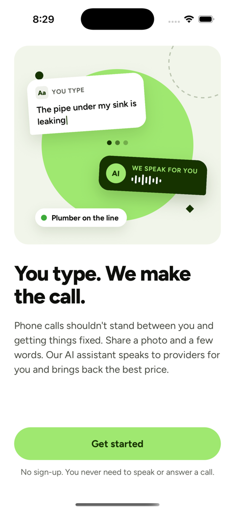
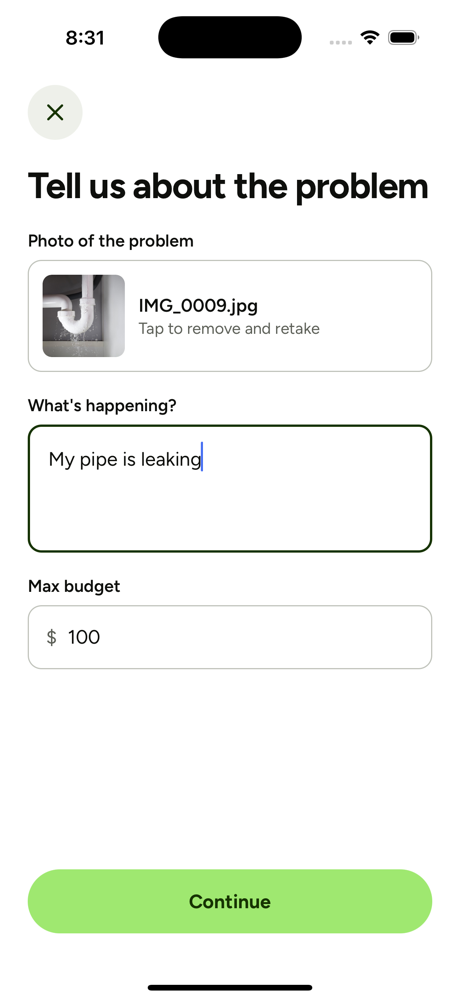
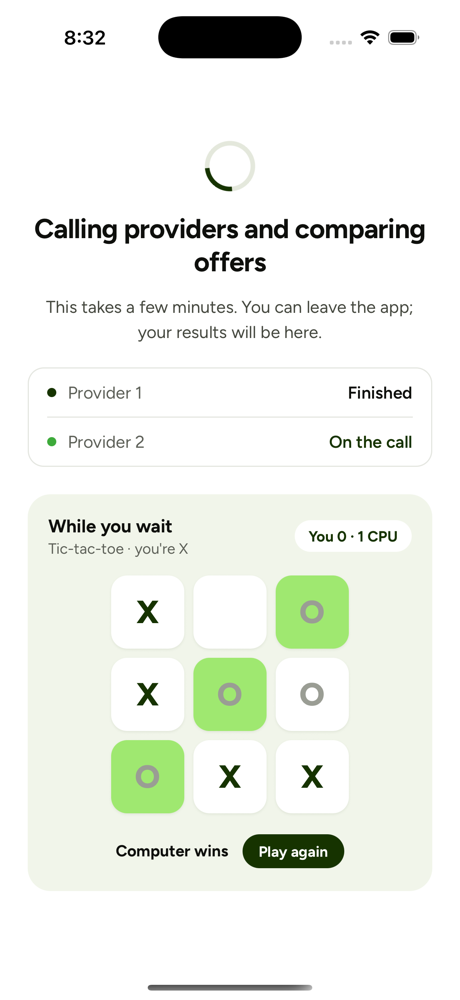
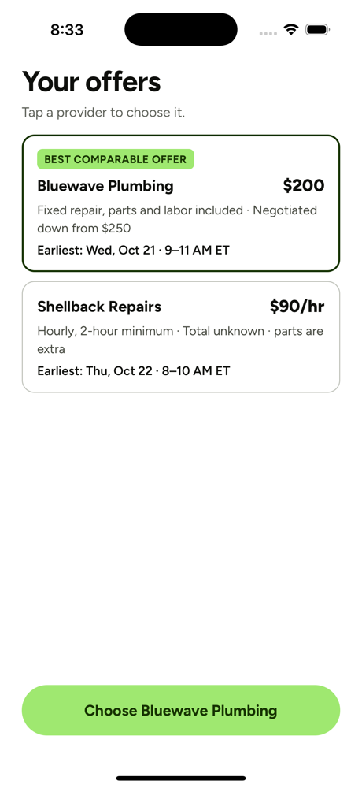

# Spoken.ai

Spoken.ai makes getting a repair quote accessible to people who can’t use spoken phone calls, including Deaf and hard-of-hearing people and people who are nonspeaking or have a speech disability. Instead of phoning around, the user shares a photo and a written description of the problem. An AI voice agent makes the calls on their behalf, negotiates, and brings back offers to compare, and the user sends a booking request by email. Every step works with text, images, and taps: no speaking, listening, or microphone needed.

<table>
  <tr>
    <td align="center" width="25%"><br><sub>Start</sub></td>
    <td align="center" width="25%"><br><sub>Describe the problem</sub></td>
    <td align="center" width="25%"><br><sub>AI calls providers</sub></td>
    <td align="center" width="25%"><br><sub>Compare offers</sub></td>
  </tr>
</table>

## How it works

1. **Describe it.** Add a photo, a few words about the problem, and a budget.
2. **Answer two questions.** Gemini reads the photo and asks what a provider would need to know.
3. **We make the calls.** Sam, an ElevenLabs voice agent, phones providers one by one, asks for a price and times, and negotiates.
4. **Compare offers.** Prices and times from each call, with the best comparable offer marked.
5. **Request a booking.** The provider gets an email with the details and a calendar file, and replies to you to confirm.

## Accessibility

- No speaking, listening, or microphone access at any step.
- Clear labels for screen readers, text that scales, and readable contrast.
- Progress and results are shown as text, never by sound or color alone.
- Sam says it is an AI assistant acting for the user, and never mentions the user’s disability.

## Built with

Expo / React Native app · Node.js and Express backend · Gemini (photo questions, offer extraction, safety checks) · ElevenLabs and Twilio (phone calls) · Resend (booking emails)

The demo calls only the team’s own phone numbers, never real businesses.

## Run it

Requires Node.js 20.6 or later.

```bash
# Backend
cd backend
npm install
cp .env.example .env   # add your API keys
npm run dev

# App (in a second terminal; open with Expo Go on the same Wi-Fi)
cd client
npm install
npx expo start
```

`CALL_MODE=simulated` in `backend/.env` (the default) uses sample conversations instead of real calls.

See [docs/technical.md](docs/technical.md) for the API, call flow, voice agent, and every setting.
